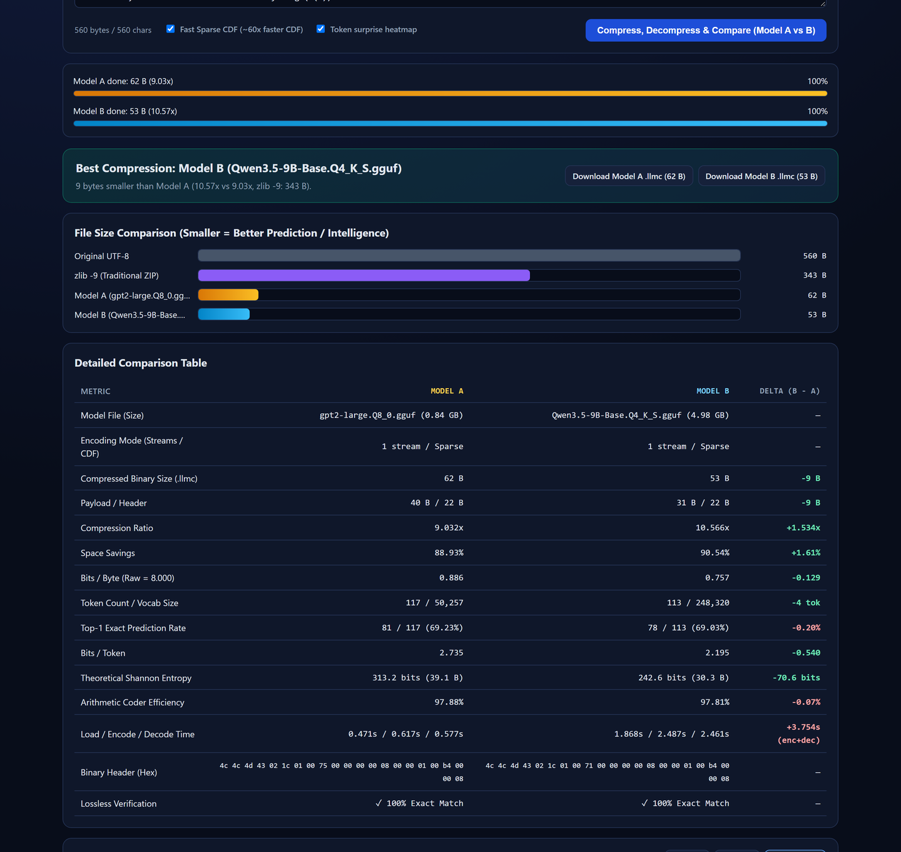
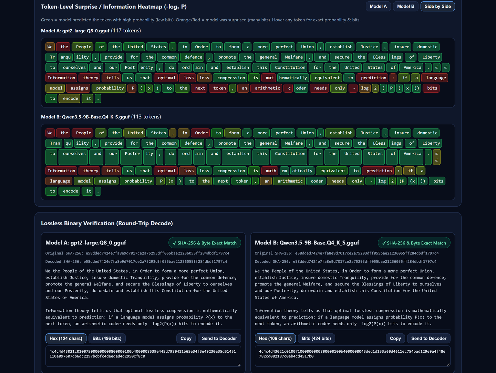

# LLM Compression Lab

[](https://www.python.org/downloads/)
[](LICENSE)

Lossless text compression, decompression, and side-by-side language model benchmarking inspired by Shannon's information theory and 3Blue1Brown's *"Compression is Intelligence"*.

**LLM Compression Lab** pairs any local `.gguf` autoregressive language model (via `llama-cpp-python` with KV-cache evaluation) with a **62-bit integer Arithmetic Coder** to compress UTF-8 text down near its theoretical Shannon entropy — often achieving **8×–11× lossless compression** on natural language where `zlib -9` reaches only ~1.6×.

---

## Highlights

- **100% Lossless Round-Trip Compression**: Encodes UTF-8 text into a compact `.llmc` binary format (with magic header, metadata, and arithmetic-coded bitstream) and verifies exact byte-for-byte / SHA-256 reconstruction.
- **Interactive Web UI (FastAPI + SSE)**:
  - Auto-discovers local `.gguf` models (e.g., LM Studio directories) or accepts any custom `.gguf` path.
  - Compares **Model A vs. Model B** sequentially (freeing VRAM between models) with live token-by-token progress bars.
  - Visualizes a **Token-Level Surprise Heatmap (`-log₂ P`)** showing exactly which tokens each model predicted confidently vs. found surprising.
  - Exports **Full (19-field)** and **Sparse (5-field + top surprises)** per-token JSON reports.
- **Fast Sparse CDF & Multi-Stream Parallelism**:
  - **Fast Sparse CDF** (~60× faster CDF construction on large 256K+ vocabularies) alongside **Exact Dense CDF** mode.
  - **Multi-Stream KV-Cache Mode** (`--streams 4/8/16`) splits long documents across parallel KV-cache lanes to accelerate throughput on GPU.
- **Inline Copyable Hex & Bitstring Mode**: Compress short payloads (≤ 10,000 bits) directly into copyable hex or `0`/`1` bitstrings and decode them back from CLI or Web UI.
- **Deterministic Bit-Exact Prototype (`deterministic_gpt2.py`)**: Self-contained NumPy GPT-2 reference implementation with integer-quantized CDFs for cross-machine bit-exact reproducibility.

---

## Web UI Preview

### Model A vs. Model B Benchmark
*GPT-2 Large (`0.84 GB`) vs. Qwen3.5-9B-Base (`4.98 GB`) compressing 560 bytes of English text to **62 B (9.03×)** and **53 B (10.57×)** respectively, compared to **343 B** for `zlib -9`.*



### Token-Level Surprise Heatmap (`-log₂ P`) & Lossless Verification
*Green tokens were predicted with high probability (few bits); orange/red tokens surprised the model (more bits).*



---

## Architecture

| File | Description |
| --- | --- |
| [`arithmetic_coder.py`](arithmetic_coder.py) | 62-bit integer `[low, high]` `ArithmeticEncoder` / `ArithmeticDecoder` with E3 underflow handling, `BitOutputStream` / `BitInputStream`, exact `float64` Softmax-to-CDF quantization (`logits_to_cdf`), and fast sparse CDF builder. |
| [`compressor.py`](compressor.py) | `LLMCompressor` engine: `.gguf` loading & hot-swapping, direct `llama_decode` KV-cache stepping, context-window rollover, multi-stream encoding/decoding, `.llmc` binary framing, inline hex/bitstring helpers, and `compare_models(...)` orchestrator. |
| [`web_app.py`](web_app.py) | FastAPI backend with Server-Sent Events (SSE) progress streaming, `.llmc` artifact downloads, inline hex/bitstring decode endpoints, and Full/Sparse JSON report endpoints. |
| [`static/index.html`](static/index.html) | Zero-build single-page dark-mode Web UI for Model A vs. Model B comparison, single-model compress/decompress, surprise heatmaps, and JSON inspection. |
| [`cli.py`](cli.py) | Command-line interface (`compress`, `decompress`, `roundtrip`, `compare`, `web`). |
| [`deterministic_gpt2.py`](deterministic_gpt2.py) | Standalone NumPy deterministic GPT-2 forward pass + bit-exact arithmetic coding prototype. |

---

## Installation

### Prerequisites
- Python **3.10+**
- A local `.gguf` language model (any `llama.cpp`-compatible model)
- *(Optional)* CUDA / Metal / Vulkan build of `llama-cpp-python` for GPU acceleration

### Setup

```bash
git clone https://github.com/TryCatchIgnoreDev/llm-compressor.git
cd llm-compressor
pip install -r requirements.txt
```

> **Tip:** For GPU acceleration with `llama-cpp-python`, follow the [llama-cpp-python installation guide](https://github.com/abetlen/llama-cpp-python#installation) to install a CUDA, Metal, or Vulkan wheel.

---

## Quick Start

### 1. Launch the Web UI

```bash
python cli.py web --port 8765
```

Then open **http://127.0.0.1:8765** in your browser.

### 2. CLI Usage

**Compare two models side-by-side:**
```bash
python cli.py compare \
  --model-a "/path/to/model-a.gguf" \
  --model-b "/path/to/model-b.gguf" \
  --text "Compression is intelligence!"
```

**High-throughput multi-stream compression on longer texts:**
```bash
python cli.py compare \
  --model-a "/path/to/model-a.gguf" \
  --model-b "/path/to/model-b.gguf" \
  --streams 8 \
  --input article.txt
```

**Single-model round-trip verification:**
```bash
# Uses Fast Sparse CDF by default; pass --exact-cdf for full-vocabulary Softmax CDF
python cli.py roundtrip \
  --model "/path/to/model.gguf" \
  --text "Information theory connects prediction directly to compression." \
  --output out.llmc
```

**Inline copyable Hex or Bitstring mode (up to 10,000 bits):**
```bash
python cli.py compress --model "/path/to/model.gguf" --text "Hello, Shannon!" --hex --bits
python cli.py decompress --model "/path/to/model.gguf" --hex "4c4c4d43..."
python cli.py decompress --model "/path/to/model.gguf" --bits "01001100..."
```

**Export detailed per-token JSON reports:**
```bash
python cli.py compare \
  --model-a "/path/to/model-a.gguf" \
  --model-b "/path/to/model-b.gguf" \
  --text "Hello world!" \
  --json-dir "./json_reports"

# Or lightweight sparse JSON only:
python cli.py compare --model-a "a.gguf" --model-b "b.gguf" --text "Hello world!" --sparse-json
```

---

## HTTP API Endpoints

When running `python cli.py web`:

| Method & Path | Description |
| --- | --- |
| `GET /` | Web UI |
| `GET /api/system` | GPU offload status & discovered `.gguf` models (`?scan_dir=...`) |
| `POST /api/compare` | Run Model A vs. Model B comparison (SSE stream) |
| `POST /api/single/compress` | Compress text with a single model (SSE stream) |
| `POST /api/single/decompress` | Decompress raw `.llmc` binary payload |
| `POST /api/single/decompress_hex` | Decompress inline hex string |
| `POST /api/single/decompress_bits` | Decompress inline `0`/`1` bitstring |
| `GET /api/compare/last/json` | Fetch latest comparison report (`?model=a\|b`, `?detail=full\|sparse`, `?download=true`) |

---

## Running Tests

```bash
python -m unittest discover -v
```

- `test_arithmetic_coder.py` runs standalone with no external model required.
- `test_compressor.py` and `test_web_app.py` run end-to-end integration tests when local `.gguf` models are available (you can point to a custom model via `LLM_COMPRESSOR_TEST_MODEL`), and automatically skip if no model is present.

---

## License

This project is licensed under the [MIT License](LICENSE).
